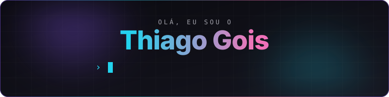

 

### Stack

  

### Connect

  

### Activity

  

<picture>
  <source media="(prefers-color-scheme: dark)" srcset="https://raw.githubusercontent.com/iamgois/iamgois/output/snake-dark.svg" />
  <source media="(prefers-color-scheme: light)" srcset="https://raw.githubusercontent.com/iamgois/iamgois/output/snake.svg" />
  
</picture>

  

